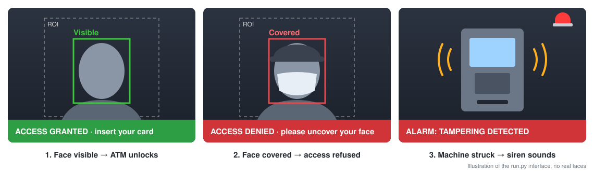
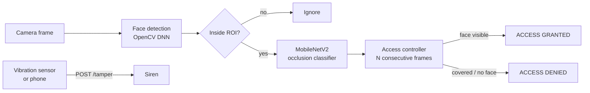

<h1 align="center">Smart ATM</h1>

<p align="center">
  <b>Face-occlusion access control and tamper alarm for ATM booths</b><br>
  The ATM unlocks only when the user's face is clearly visible, and a siren sounds when someone tries to break the machine.
</p>

<p align="center">
  
  
  
  <a href="https://github.com/jkthokar/smart-atm/actions/workflows/tests.yml"></a>
  <a href="LICENSE"></a>
</p>

<p align="center">
  
</p>

## Why

People who attack ATMs usually hide their faces, so CCTV records the crime but can't identify anyone. Smart ATM acts **before** a transaction: it refuses service to users whose faces are covered and raises an alarm as soon as the machine is tampered with.

## Features

| | |
|---|---|
| **Real-time face detection** | OpenCV DNN (ResNet-10 SSD). Runs on a normal CPU with no GPU. |
| **Face-occlusion classifier** | MobileNetV2 transfer learning. Covered means a mask, helmet, cap, hood or scarf. |
| **Fail-safe access logic** | Access is granted only after a visible face is confirmed over several frames in a row. Covered or undetectable faces are always denied. |
| **Region of interest** | Only the area in front of the ATM is checked, so people passing by are ignored. |
| **Tamper alarm** | Any device can trigger the siren with `POST /tamper`: an ESP32 vibration sensor, a smartphone, or `curl`. |
| **Reproducible ML pipeline** | Data collection, a person-level train/test split, training, and evaluation (precision, recall, F1, confusion matrix). |
| **Privacy by design** | No face images in this repo. The live demo processes frames in memory and saves nothing. |
| **Tested** | Unit tests for the decision logic, ROI and tamper listener, run with GitHub Actions CI. |

## How it works



**Why fail-safe?** If the detector can't find a face, for example because it is fully covered, the system never grants access. A clear, visible face is the only way to unlock the ATM.

## Quick start (2 minutes, no dataset needed)

```bash
git clone https://github.com/jkthokar/smart-atm.git
cd smart-atm
python -m venv .venv
source .venv/bin/activate          # Windows: .venv\Scripts\activate
pip install -r requirements.txt
python download_models.py          # face detector, about 10 MB
python run.py --detector-only      # live webcam demo: face detection, ROI and alarm
```

Drag a box around the area in front of the ATM (the ROI), then press **Enter**. Press **T** to test the alarm.

| Key | Action |
|---|---|
| `Q` | Quit |
| `R` | Reselect the ROI |
| `T` | Test the alarm |
| `S` | Silence the alarm |

Trigger the alarm from another device on the same network:

```bash
curl -X POST http://<pc-ip>:8765/tamper
```

## Full system: train your own classifier

Face images are personal data, so **no dataset is included**. Use one of these two options.

**Option A: record your own data** (with the consent of everyone you record)

```bash
python collect_data.py --person alice   # hold G = face visible, D = face covered
python split_dataset.py --by-person     # 80/20 split; no person appears in both sets
```

**Option B: use a public face-mask dataset.** Check its license first. Put the images in `dataset/raw/access_granted/` and `dataset/raw/access_denied/`, then run `split_dataset.py`. Most public datasets contain only masks, so add images of helmets, hoods and scarves for better coverage.

Then train, evaluate and run:

```bash
python train.py      # MobileNetV2 transfer learning -> models/smart_atm_classifier.keras
python evaluate.py   # results/metrics.json, confusion_matrix.png, training_curves.png
python run.py        # full system: access granted / denied + alarm
```

See [dataset/README.md](dataset/README.md) for tips on building a good dataset.

## Project structure

```
smart-atm/
├── smart_atm/                 core package
│   ├── config.py              all settings in one place
│   ├── face_detector.py       OpenCV DNN face detector
│   ├── classifier.py          MobileNetV2 model and inference
│   ├── decision.py            fail-safe access controller
│   ├── roi.py                 region-of-interest helpers
│   ├── tamper.py              HTTP listener for tamper sensors
│   └── alarm.py               siren (no extra dependencies)
├── run.py                     live system and demo
├── download_models.py         fetch face-detector weights
├── collect_data.py            build a dataset with a webcam
├── split_dataset.py           train/test split (optionally by person)
├── train.py                   train the classifier
├── evaluate.py                metrics and plots
├── hardware/                  ESP32 + SW-420 vibration sensor sketch
├── tests/                     unit tests (pytest)
└── docs/images/
```

## Configuration

All thresholds live in [`smart_atm/config.py`](smart_atm/config.py):

| Setting | Default | Meaning |
|---|---|---|
| `grant_threshold` | 0.80 | Classifier confidence needed to count a face as visible |
| `frames_to_grant` | 8 | Visible-face frames in a row before access is granted |
| `frames_to_deny` | 5 | Covered-face frames in a row before access is denied |
| `roi_min_overlap` | 0.6 | Fraction of a face box that must lie inside the ROI |
| `tamper_port` | 8765 | Port for external tamper sensors |

## Background

This project started as my undergraduate research at **Kyungdong University (Global)**, supervised by **Prof. Nur Alam MD**. The original version (v1) used YOLOv3 for face detection, a CNN classifier and a smartphone motion sensor, and reached **94.74%** test accuracy on a private dataset. The original code was lost, so this repository is a clean **v2 re-implementation**. It adds a lighter face detector, a reproducible training and evaluation pipeline, fail-safe access logic, network-based tamper sensors and tests.

## Limitations and ethics

- Accuracy depends on the training data. Lighting, camera angle and unusual coverings can reduce performance.
- Some people cover their faces for medical, religious or weather reasons. A real deployment needs an alternative route, such as help from staff, instead of simply refusing service.
- Face images are biometric data. Collect them only with informed consent, and never publish them.
- This is a research prototype, not a certified security product.

## Roadmap

- [ ] Benchmark against other models (ResNet50, EfficientNet, YOLOv8)
- [ ] Measure FPS on CPU and edge devices (Raspberry Pi, Jetson Nano)
- [ ] Weapon-scanning smart door
- [ ] Withdrawal alerts to account holders with location and a video clip

## Author

**Jay Kumar Tamang**, Kyungdong University (Global)
[LinkedIn](https://www.linkedin.com/in/jay-kumar-tamang-3aa505214) · [GitHub](https://github.com/jkthokar)

## Acknowledgments

Thanks to Prof. Nur Alam MD, and to Prof. Ahmed A. Al-Absi, Prof. Baseem Al-Athwari and Prof. Zubaer Ibna Mannan, for their guidance. The face detector is [OpenCV's ResNet-10 SSD](https://github.com/opencv/opencv/tree/master/samples/dnn/face_detector).

## License

Released under the [MIT License](LICENSE).
